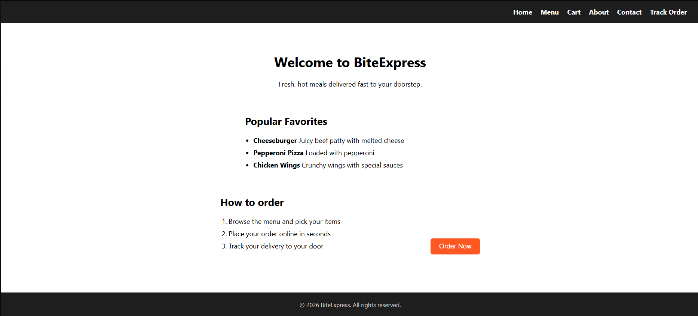
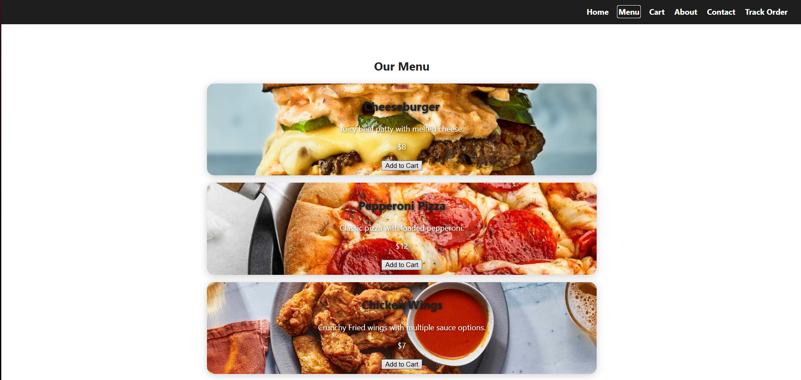
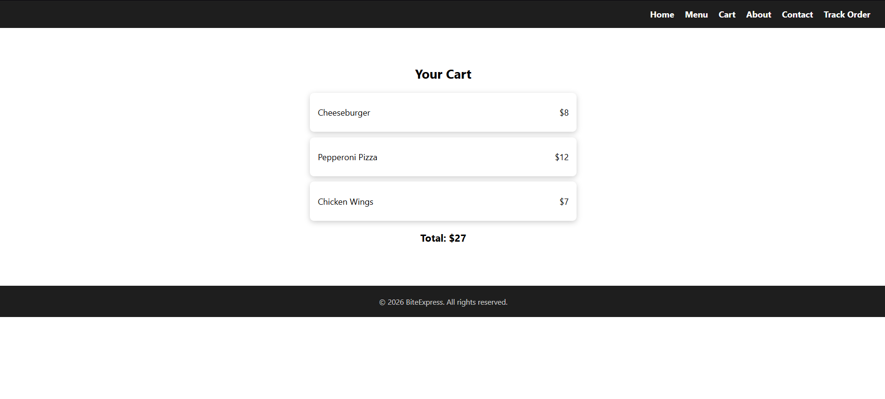
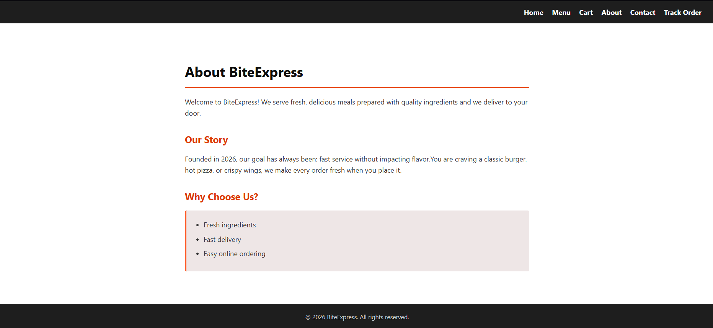
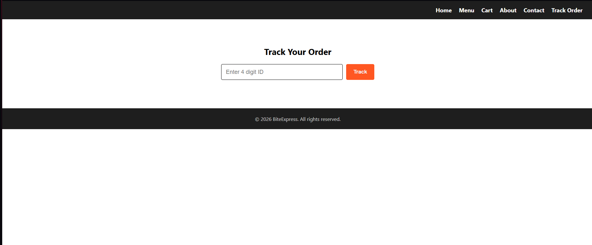
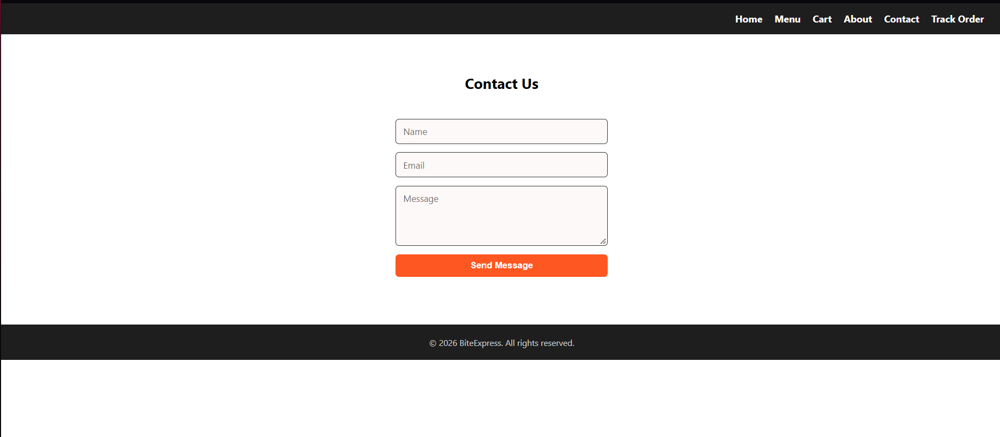

# BiteExpress

BiteExpress is a responsive restaurant ordering web application built with ReactJS. Customers can browse the menu, add items to their cart, and track their orders online.

## Live Links
- **Live Website:** https://bite-express-nu.vercel.app
- **GitHub Repository:** https://github.com/0alisabbah-hash/BiteExpress

## Features
- **Multi-Page Navigation:** Home, Menu, Cart, About, Contact, and Track Order pages.
- **Interactive Menu, Cart & Tracking:** Add dishes, simulate order tracking, and view real-time total values.
- **Responsive Design:** Works across desktop and mobile screens.

## Technologies Used
- ReactJS
- React Router
- CSS3
- Vercel (Hosting)

## Screenshots

### Home Page


### Menu Page


### Cart Page


### About Page


### Track Order Page


### Contact Page


## How to Run Locally

1. Clone the repository:
   ```bash
   git clone https://github.com/0alisabbah-hash/BiteExpress.git
   ```
2. Open the project folder and install dependencies:
   ```bash
   cd BiteExpress
   npm install
   ```
3. Run the app:
   ```bash
   npm start
   ```
4. Open http://localhost:3000 in your browser.


## Author
Ali Sabbah